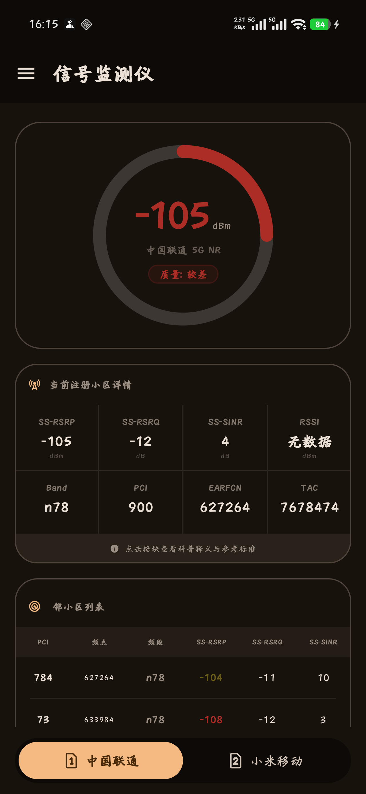
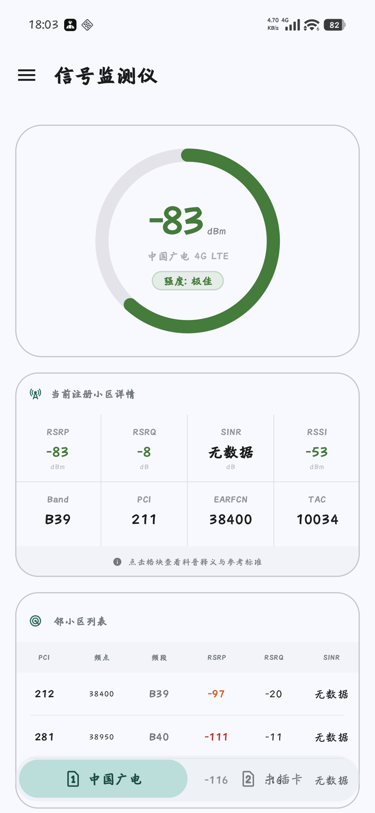

# 信号监测仪 · Signal Insight

**看得懂手机信号的应用。** 实时显示你所在位置的 4G / 5G 信号强度与质量，把 RSRP、SINR 这些专业参数翻译成普通人能理解的话。

[](https://github.com/hpmdr/Signal-Insight/releases/latest)

> **下载地址：** <https://github.com/hpmdr/Signal-Insight/releases/latest>
>
> 在页面底部的 **Assets** 中点击 `SignalInsight-v1.1.2-release.apk` 即可下载（文件名中的版本号会随新版本变化）。

<table>
  <tr>
    <td width="50%"></td>
    <td width="50%"></td>
  </tr>
  <tr>
    <td align="center">深色模式</td>
    <td align="center">浅色模式</td>
  </tr>
</table>

---

## 它能帮你做什么

### 一眼看清信号好坏

不用记 dBm 数值，应用会用**颜色和环形进度**告诉你现在信号是「优秀」还是「极弱」，并给出一句人话结论。

### 双卡同时监测

两张 SIM 卡各自独立采集，左右滑动或点击底部胶囊即可切换，卡片上直接显示各自的运营商和实时信号。

### 8 项核心指标，一项不糊弄

| 指标 | 含义（简单说） |
|------|--------------|
| **RSRP / SS-RSRP** | 信号强度，最常用的那个数 |
| **RSRQ / SS-RSRQ** | 信号质量，看有没有被干扰 |
| **SINR / SS-SINR** | 信噪比，直接决定你能跑多快 |
| **RSSI** | 总接收功率 |
| **Band** | 当前连的是哪个频段（n41、B3…） |
| **PCI** | 小区标识，判断是否在同一个基站 |
| **EARFCN** | 频点编号，可换算成实际频率 |
| **TAC** | 跟踪区编号，用于定位你在哪个片区 |

指标名称会随网络类型自动变化（5G 显示 SS-RSRP，4G 显示 RSRP），设备或系统没上报的项目会老实显示「无数据」，不会用 0 或乱码糊弄你。

### 邻小区列表

看到周围其他基站的 PCI、频点、频段和信号强度，方便判断当前的弱信号是不是「没别的基站可连」。

### 综合评分与诊断

点一下信号环，进入综合分析页：0–100 分、评级、诊断说明，以及**针对当前短板的改善建议**（比如「靠近窗户」）。评分只统计当前网络真正可用的参数，不会因为系统没提供 SINR 就把你判成「信号差」。

### 每个参数都有科普

点任意指标格，进入专属解读页：

- 这个参数到底是干什么的
- 多少算好、多少算差（分级表）
- 对你刷视频、打游戏的实际影响
- 结合**你当前的真实数值**给出个性化评估

比如 SINR 页面会直接告诉你「当前 12 dB，属于流畅档，4G 大致对应 50~80 Mbps、5G 大致对应 300~500 Mbps」。

### 外观随你

- 深色 / 浅色模式自适应
- 12 套配色方案，或跟随系统壁纸取色（Material You）
- 信号刷新速度可选：快速（2 秒）/ 慢速（5 秒）
- 中文 / 英文自动跟随系统语言

---

## 为什么选它

| 优势 | 说明 |
|------|------|
| **无广告** | 没有开屏广告、没有横幅、没有弹窗，没有「看广告解锁」 |
| **不联网** | 应用**没有申请网络权限**，安装包里也不存在 `INTERNET` 权限，从系统层面就无法上传任何数据 |
| **安装包小** | 约 **2.4 MB**，不占空间、下载快、老机型也无压力 |
| **不收集隐私** | 无需注册登录；不读取通讯录、短信、相册；不申请任何与功能无关的权限 |
| **免费开源** | Apache License 2.0，代码公开，任何人都能审查它到底做了什么 |
| **数据来自系统** | 数值直接读系统上报的基站信息，不做估算和编造 |
| **专注 4G / 5G** | 指标、评分与科普全部围绕 4G / 5G 打磨 |

> 想自行验证「不联网」？用任意 APK 权限查看器打开安装包，权限列表里找不到「网络 / INTERNET」这一项——没有这项权限，应用在技术上不可能发出任何请求。

---

## 下载与安装

### 系统要求

- Android **12 及以上**（API 31+）
- 需要一张已插入且有 **4G / 5G** 覆盖的 SIM 卡（双卡机型可分别查看两张卡）

### 安装步骤

1. 打开 [**Releases 页面**](https://github.com/hpmdr/Signal-Insight/releases/latest)，在最新版本的 **Assets** 中下载 `SignalInsight-v1.1.2-release.apk`
2. 用文件管理器点击安装；若系统提示「禁止安装未知应用」，按提示为浏览器或文件管理器**允许安装未知应用**
3. 首次打开时授予两项权限（见下方说明），即可进入主界面
4. 升级新版本时直接覆盖安装即可，**无需卸载**，设置会保留

> 请始终从本仓库的 Releases 页面下载。其他渠道二次打包的安装包可能被篡改，且签名不同，将无法覆盖升级。

### 需要哪些权限，为什么

| 权限 | 用途 | 是否必须 |
|------|------|---------|
| **电话**（`READ_PHONE_STATE`） | 读取运营商名称、网络制式、SIM 卡信息 | 必须 |
| **位置**（`ACCESS_FINE_LOCATION`） | Android 系统规定：读取基站信息必须先授予位置权限 | 必须 |

关于位置权限，需要说清楚：

- 这是**系统强制要求**，不是应用想定位你。Android 从 10 开始就把「基站信息」归类为可能推断位置的数据。
- 应用**不会**读取 GPS、不会显示你的坐标、不会记录你去过哪里，更没有网络权限把任何东西发出去。
- 拒绝授权则无法获取基站数据，应用会停留在授权页。

---

## 常见问题

**Q：为什么有些指标显示「无数据」？**
A：要么当前网络本身没有这个概念（比如 5G 没有 RSSI），要么是你的手机/系统没有上报（部分机型在 4G 下不提供 SINR）。应用如实显示，不做猜测填充。

**Q：为什么选择「快速刷新」，数字却不是每 2 秒都变？**
A：刷新请求由系统统一调度并限流，官方明确说明「不保证按请求频率更新」。信号稳定时数值本来也不会有明显变化。

**Q：装了之后在系统设置里找不到「网络」权限？**
A：因为应用根本没有申请网络权限，系统自然不会列出这一项。这是刻意设计，不是权限被隐藏。

**Q：这个分数是运营商测速吗？**
A：不是。评分只反映**当前无线链路的质量**（强度、质量、信噪比），与你的套餐带宽、服务器负载、测速节点无关。

**Q：能看 Wi-Fi 信号吗？**
A：目前只做蜂窝网络（4G / 5G）。

---

## 反馈与建议

遇到问题或有功能建议，欢迎在 [Issues](https://github.com/hpmdr/Signal-Insight/issues) 中反馈。如果对你有帮助，给个 Star 是最大的鼓励。

---

## 开源协议

本项目基于 [Apache License 2.0](LICENSE) 开源，Copyright 2026 hpmdr / debumao。

<details>
<summary>开发者：从源码构建</summary>

```bash
git clone https://github.com/hpmdr/Signal-Insight.git
cd Signal-Insight

# 首次构建前，在项目根目录创建 local.properties，写入 SDK 路径
echo "sdk.dir=/path/to/android-sdk" > local.properties

./gradlew assembleDebug      # 调试包
./gradlew assembleRelease    # 发布包（R8 + 资源压缩）
./gradlew testDebugUnitTest  # 单元测试
```

- 环境：JDK 17+、Android SDK Platform 37.2、Build-Tools 37.0.0（Gradle 由 wrapper 自动下载）
- 正式分发包一律由 GitHub Actions 使用仓库 Secrets 中的密钥签名构建，本地 `assembleRelease` 的产物**不要**对外分发
- 详细页面与功能说明见 [`doc/页面与功能文档.md`](doc/页面与功能文档.md)，签名与分发规范见 [`doc/签名密钥与分发规范.md`](doc/签名密钥与分发规范.md)

</details>
